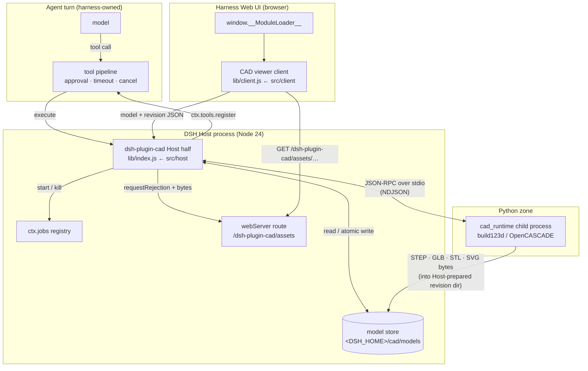
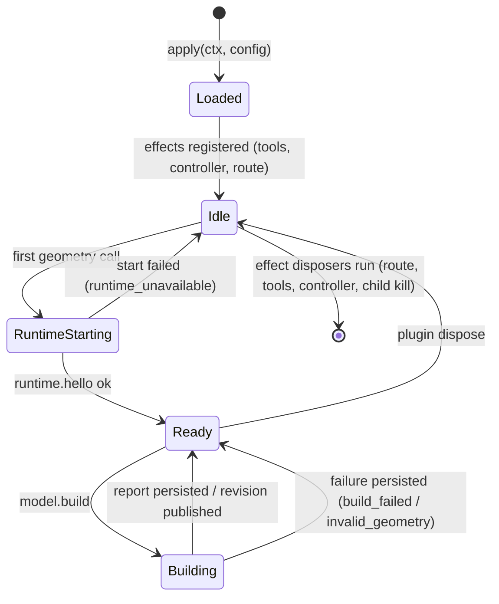
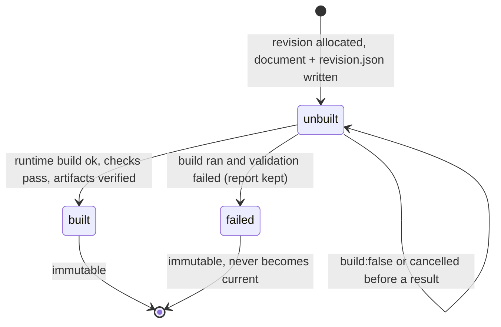

# dsh-plugin-cad — Architecture

- **Status:** P0 design, implemented across M0–M5 (see the status table in §9 and
  `docs/IMPLEMENTATION_PLAN.md`)
- **Pinned platform:** DeepSeek Harness `0.2.1-rc.3`, `@deepseek-ai/cordis 4.0.5`
  (see `docs/COMPATIBILITY_MATRIX.md`)
- **Verified tree:** git commit `7b5d88f` (113 files, 28,709 insertions); acceptance
  **12 PASS / 0 FAIL / 0 PARTIAL** (E†: independent parser, not a commercial CAD
  app) at that commit
- **Normative inputs:** `docs/research/DSH_PLUGIN_API_NOTES.md` (host recon),
  `docs/research/SPEC_P0.md` (product spec), `src/contracts/*.js` (tool and wire
  contracts)

This document describes **how the plugin is put together and why**. The reasons
live in the ADRs (`docs/adr/`); the exact agent tool contract lives in
`src/contracts/tools.js`; the wire contract lives in `src/contracts/protocol.js`
and `docs/CAD_RUNTIME_PROTOCOL.md`.

---

## 1. Purpose and scope

A Harness user describes a mechanical part in natural language. The agent turns
it into a **declarative CAD document** (named parameters + an ordered feature
list), native Harness tools persist it and ask a long-lived Python runtime
(build123d → OpenCASCADE) to build a real B-rep, validate it and export
engineering artifacts (STEP / GLB / STL / SVG). The Harness Web UI displays the
model in an in-Harness 3D viewer; a parameter change produces a new **immutable
revision** that the viewer picks up.

Acceptance part (from the brief, specified in `docs/research/SPEC_P0.md` §1): a
rectangular mounting bracket 80 × 60 × 8 mm, Ø20 mm central through-hole, four
Ø6 mm corner holes inset 12 mm, then the same bracket with modified parameters.

P0 handles **single parts only**. Assemblies, drawings, DFM rule packs, sheet
metal and CAM are explicit non-goals (§10).

---

## 2. System context



Three halves, three trust domains:

| half | runs in | language | owns | does **not** own |
| --- | --- | --- | --- | --- |
| **Host** | Harness Host process (Node 24.21.0) | JS/TS, Cordis plugin | documents, revisions, artifact store, tool surface, jobs, HTTP asset route, runtime supervision | geometry kernels, browser UI |
| **Client** | Harness Web UI page | JS (esbuild IIFE bundle, React external) | 3D viewer + sidebar entry, artifact fetch, revision polling | geometry, file I/O, auth, harness internals |
| **Runtime** | child process, uv CPython 3.12.13 | Python (`build123d`, `trimesh`, `numpy`) | B-rep construction, validation, tessellation, export bytes | model identity, revisions, HTTP, jobs, user data |

The Host is the only component allowed to decide *whether* work happens (tool
pipeline, jobs) and the only component allowed to talk to the filesystem. The
runtime cannot be reached from the browser, and the browser cannot name a file.

---

## 3. Host half

Entry point: `package.json` → `main: "./lib/index.js"`, loaded as a Cordis
plugin module. The module exports `name`, `inject` and `apply(ctx, config)`
(documented contract in `docs/research/DSH_PLUGIN_API_NOTES.md` §2); **every**
registration happens inside `apply()` as an `ctx.effect` with a disposer, so
disable/unload leaves nothing behind.

Responsibilities:

1. **Tool surface.** Nine native tools, registered through
   `ctx.tools.register`, names fixed in `src/contracts/tools.js` `TOOL_NAMES`:

   | tool | role |
   | --- | --- |
   | `cad_create_model` | validate + store a document, build revision 1 |
   | `cad_modify_model` | parameter / feature edit → revision N+1 |
   | `cad_inspect_model` | read metadata, report, optionally document/history |
   | `cad_validate_model` | run validation checks without creating a revision |
   | `cad_export_model` | copy artifacts into a workspace directory |
   | `cad_render_preview` | SVG projection of a revision |
   | `cad_list_models` | browse the store |
   | `cad_get_job_status` | read/cancel a background build job |
   | `cad_runtime_status` | probe the Python runtime, optionally repair install |

   Each tool declares an object-rooted `parameters` JSON Schema and a mandatory
   `output.schema` + `render` (`docs/research/DSH_PLUGIN_API_NOTES.md` §3), and
   returns the envelope `{ok:true,…}` / `{ok:false,error:{code,message,details}}`
   with codes from `src/contracts/errors.js`.

2. **Revisioned store.** Owns the `<DSH_HOME>/cad/models` tree (overridable with
   `dataDir`), atomic writes, sha256 + byte accounting, and the optimistic
   concurrency / idempotency rules of ADR-0003.

3. **Build pipeline.** Validates the document, queues builds serialised per
   model, and bounds global concurrency with `maxConcurrentBuilds` (default 1).
   It calls the runtime's `model.build` / `model.validate` and persists the
   report.

4. **Runtime supervisor.** Spawns and owns the single Python child process
   (ADR-0002), does version negotiation (`runtime.hello`), health probes
   (`runtime.health`), crash detection + restart with backoff, and kills the
   child on dispose.

5. **HTTP asset route.** `ctx.inject(['webServer'], …)` registers the
   `/dsh-plugin-cad/assets` prefix route, admitted by the harness connection
   service, serving only files inside the store (ADR-0005).

6. **Job controller.** Registers the `cad` `ctx.jobs` controller once
   (ADR-0004) and runs background builds as Harness jobs owned by `exec.agent`.

### Host lifecycle



Note the deliberate asymmetry: the runtime starts **lazily** (a user who only
inspects models never pays the Python start), but is **reused** for the process
lifetime (ADR-0002 latency measurements).

---

## 4. Client half

`package.json` `exports["./client"] → ./lib/client.js`, declared under
`dsh.client` with `platform: "web"`, `immediately: true` and three injected
client packages (`@deepseek-ai/dsh-client-locale`,
`-ui-layout`, `-ui-sidebar`). The Node side of
`@deepseek-ai/dsh-client-modules` scans enabled loader entries, resolves the
built bundle, hashes it into `window.__DSH_BOOT__` and serves it under the
plugin prefix (`docs/research/DSH_PLUGIN_API_NOTES.md` §6).

The bundle is a **factory-registration file**, not an ESM module:

```js
window.__ModuleLoader__.load({
  id: "dsh-plugin-cad",
  factory(require) { /* esbuild IIFE with globalName __dshPluginCad */ return __dshPluginCad },
});
```

Built with esbuild as IIFE, `react` / `react-dom` **external** (resolved from the
page's shared module table — never bundle a second React), CSS via
`--loader:.css=text` and injected as a style element.

The client plugin's `apply(ctx)` registers, all as effects:

- a locale namespace (`ctx.locale.register(...)` + `ctx.locale.bind`);
- the main-panel page via `ctx.slots.inject('main', …)`
  (`ctx.slots.register({name:'main', key:'dsh-plugin-cad', …}, CadViewerPage)`);
- the sidebar entry via `ctx.slots.inject('sidebar.panellist', …)`
  (`order: 40`, icon + label).

Data flow inside the viewer:

1. list models (`cad_list_models`-equivalent read path over the Host route /
   plugin API — the client never imports harness internals);
2. fetch the current revision metadata + artifact references;
3. fetch the GLB by reference URL (same origin) and render it with three.js;
4. poll/refresh on revision change and hot-swap, keeping the previous frame
   until the new artifact is fully loaded — never display a partially built
   revision (ADR-0003);
5. optional SVG preview from `cad_render_preview` as a 2D fallback.

---

## 5. Python runtime

Package: `python/cad_runtime/` (invoked as `python -m cad_runtime`,
`RUNTIME_MODULE` in `src/host/config.ts`); dependencies pinned in
`python/requirements.txt` (`build123d==0.13.0`, `trimesh==5.2.0`,
`numpy==2.5.4`, on the uv-managed CPython 3.12.13). Bootstrap:
`python/setup-runtime.mjs` (`node python/setup-runtime.mjs` /
`npm run setup:python`), which is also what `cad_runtime_status
{action:"repair"}` invokes when `allowRuntimeInstall` permits it.

It exposes exactly the methods in `src/contracts/protocol.js`:
`runtime.hello`, `runtime.health`, `runtime.shutdown`, `model.build`,
`model.validate`, `job.cancel`; and pushes `build.progress` / `runtime.log`
notifications. Newline-delimited JSON-RPC 2.0 over stdio, one object per line,
frames > 8 MiB refused. A build runs on a worker thread serialised by a build
lock; stdout carries protocol frames only (`python/cad_runtime/server.py`).

The runtime is **stateless with respect to models**: it receives a validated
document and an `outputDir` that the Host has prepared
(`src/host/service.ts` uses the revision directory), builds one B-rep, validates
it, writes artifacts into that directory and returns the report. Artifact writes
are themselves confined and atomic (`python/cad_runtime/artifacts.py`): tmp file
+ `os.link` so an existing artifact is never overwritten, no subdirectories, a
SIGKILL can only leave a hidden `.dsh-cad-tmp-*` file, and writes outside
`outputDir` are refused. The Host then re-hashes the declared artifacts and
records them (bytes + sha256) in `revision.json`. The runtime never owns a model
id, a revision number or a user path, which is what lets it be killed and
restarted without data loss (ADR-0002 consequence).

Geometry pipeline: document → build123d builder → single solid → validity and
metric checks → tessellation (`trimesh`, welded vertices, watertight test) → GLB
+ STEP (+ STL) → SVG projection on demand. Checks and their semantics are
specified in `docs/research/SPEC_P0.md` §5.

---

## 6. Data model

The concrete types live in `src/host/types.ts`; these are the persisted records.

```
model index  (model.json, schema "dsh.cad/model@1")
  id / modelId    "m-1a2b3c4d5e"
  name, description, metadata{}
  ownerSession    audit only; reads are never fenced by it
  createdAt, updatedAt
  currentRevision number  pointer to the latest *successful* (built) revision
  latestRevision   number  newest allocated revision (may be failed/unbuilt)
  nextRevision     number  monotonic allocator; numbers are never reused
  revisions        [RevisionSummary]  number, revisionId, status, documentSha256,
                                     artifact metadata, errorCode, reportSummary
  requests{}       request_id → {number, kind, at} (mirrors requests.json)

revision     (revision.json, schema "dsh.cad/revision@1"; immutable once written)
  revisionId      "r-0001"
  number          integer
  status          built | failed | unbuilt
  buildKind       create | modify | rebuild | preview
  documentSha256  hash of the exact document snapshot
  document.json   dsh.cad/document@1 snapshot (immutable)
  report.json     geometry report (schema "dsh.cad/geometry-report@1")
  formats[]       formats requested for this build
  artifacts[]     ArtifactMeta   step | glb | stl | svg
  error           {code, message, details?} | null
  warnings[]      string[]
  durationMs, buildId, buildRequestId, ownerSession, createdAt, builtAt

geometry report
  valid, volume, surfaceArea, centroid
  boundingBox {min,max,size}   (alias `bbox` kept for the E2E verifier)
  topology {faces, edges, vertices, solids}
  checks[{id, status: pass|fail|warn, message}]
  featureReports[{id, op, status, detail}]
  warnings[], timings{}

artifact (ArtifactMeta + ArtifactRef)
  format          step | glb | stl | svg
  fileName        model.step | model.glb | model.stl | preview.svg
  bytes, sha256, contentType
  artifactId      "m-1a2b3c4d5e:r-0002:glb"
  url             same-origin asset path
                  "/dsh-plugin-cad/assets/models/<modelId>/<revisionId>/<fileName>"
```

Ids are validated by anchored patterns (`src/host/paths.ts`):
`MODEL_ID_PATTERN = /^m-[0-9a-f]{10}$/`, `REVISION_ID_PATTERN = /^r-\d{4,}$/`;
artifact filenames are a closed set (`ARTIFACT_FILE_NAMES`), so a caller cannot
name a path at all.

Document shape (`dsh.cad/document@1`) is specified in `docs/research/SPEC_P0.md`
§3; the model-facing schema is `src/contracts/tools.js` `document`/`feature`.

On-disk layout (default root, override with `dataDir`):

Default root `<DSH_HOME>/cad` (override with `dataDir`); layout from
`src/host/store.ts`:

```
<dataDir>/
  models/<modelId>/model.json                          # model index (pointer + history)
  models/<modelId>/revisions/r-0001/document.json      # immutable document snapshot
  models/<modelId>/revisions/r-0001/revision.json      # immutable revision metadata
  models/<modelId>/revisions/r-0001/report.json        # geometry report
  models/<modelId>/revisions/r-0001/model.step         # artifacts live in the revision dir
  models/<modelId>/revisions/r-0001/model.glb
  models/<modelId>/revisions/r-0001/model.stl          # when requested
  models/<modelId>/previews/r-0001/preview.svg         # derived cache, never authoritative
  models/<modelId>/exports/r-0001/*                    # derived re-export cache
  requests.json                                        # request_id → revision idempotency index
  venv/                                                # optional; one interpreter-resolution candidate
```

Writing rules enforced by the store, not by callers:

- a revision directory is **write-once**; a later build only completes the
  already-allocated revision;
- host-written JSON goes through **tmp-file + fsync + rename**
  (`CadStore.writeAtomic`); runtime-written artifacts go through **tmp-file +
  `os.link`** (`python/cad_runtime/artifacts.py`) and are then re-hashed by the
  host. Either way a crash leaves old bytes or complete new bytes, never a torn
  file;
- revision numbers are **monotonic and never reused**;
- `expected_revision` is checked against the pointer under a per-model in-memory
  lock, and a `request_id` replay returns the existing revision;
- every path goes through `safePath`, so neither `..` nor a symlink can leave the
  store root;
- nothing is deleted on dispose/uninstall.

### Revision state machine



Status vocabulary is the implementation's (`src/host/types.ts` `RevisionStatus`):
`built` | `failed` | `unbuilt`. `currentRevision` advances only on `built`
(ADR-0003); `latestRevision` may point at a failed/unbuilt revision, which is how
the viewer can be told "the newest attempt failed" while still showing the last
good model. `latestRevision`/`currentRevision` are separate fields in
`model.json` for exactly that reason.

---

## 7. Request lifecycles

**Create (foreground).** `cad_create_model {document}` → schema validation
(failure: `invalid_document`, no revision) → model id allocated → revision 1
`unbuilt` → build → `built` → response `{ok:true, model_id, revision, artifacts,
report_summary}`. Foreground uses `buildTimeoutMs` (180 s default).

**Create (background).** Same, but `background: true` → `ctx.jobs.start` →
response `{ok:true, job_id}` immediately; the job's `done` settles the same
records; `cad_get_job_status` reads or cancels it.

**Parameter edit.** `cad_modify_model {model_id, expected_revision, parameters:{length:90}}`
→ pointer check (`revision_conflict` on mismatch) → pre-build validation
(`invalid_argument`, no revision) → revision N+1 → build → pointer advances.
A `request_id` replay returns the existing revision instead of creating N+2.

**Viewer refresh.** Client polls revision metadata; on pointer change it fetches
the new GLB by URL and swaps only after load. Failed revisions never become
current, so the viewer stays on the last good model.

**Export.** `cad_export_model {model_id, formats, output_path?, overwrite?}` →
artifacts copied to a workspace-relative directory after path-escape and
overwrite checks (`path_escape` 403, existing file without `overwrite` rejected),
returning written paths + sha256, never bytes.

**Cancel.** `cad_get_job_status {job_id, action:"cancel"}` → `ctx.jobs.kill` →
controller `cancel()` → `job.cancel` to the runtime → runtime aborts the build
and returns `cancelled`. The runtime itself must stay healthy and reusable
(brief scenario H).

> **Recorded H history (now PASS).** Cancellation failed three times, each time
> for a distinct `dsh-jobs-local` 0.1.1→0.2.1 contract drift found by a recorded
> run: (1) `JobStart.owner` had to be the session-id string, not the Agent object;
> (2) the registry also fences `get/read/kill/list` by caller, so the *caller*
> must be that session-id string; (3) `read(id)` returns
> `{chunks,lossy,result,job}`, not the typings' `{text,snapshot}`. All three were
> fixed by host-eng with regression tests. The fourth run passed: the queued job
> reached terminal `killed`, the cancelled revision was persisted
> `failed`/`cancelled` with 0 artifacts, and the runtime stayed healthy. Full
> history: `docs/TEST_REPORT.md` §3, `tests/e2e/RESULTS.md` §H/§H-PASS.

---

## 8. Trust boundaries

| boundary | crossing | control |
| --- | --- | --- |
| model → tool | JSON args | strict JSON Schema (`additionalProperties:false`), harness pipeline approvals/timeouts/cancel |
| tool → Host | validated document | document schema validation before any revision exists |
| Host → runtime | NDJSON RPC | fixed method set, 8 MiB frame cap, protocol version handshake, no code payload (ADR-0001) |
| runtime → Host | report + artifact bytes | Host owns destinations and paths; runtime never names a user path |
| browser → Host route | HTTP GET | harness connection admission (`requestRejection`), same origin, store-confined path resolution |
| Host → filesystem | store + export | store root confined, export confined to workspace, `path_escape`/`too_large` rejected |

Full policy (approval points, roots, temp isolation, retention, telemetry and
network posture) is `docs/SECURITY_MODEL.md`.

---

## 9. Component status and evidence

Architecture is complete at the design level. Implementation status is recorded
per milestone in `docs/IMPLEMENTATION_PLAN.md`; the authoritative machine-verified
evidence is in `docs/research/STATUS_host.md`, `STATUS_client.md`,
`STATUS_runtime.md` and `tests/e2e/RESULTS.md`.

| area | contract file | status |
| --- | --- | --- |
| tool surface (9 tools) | `src/contracts/tools.js` | contract frozen |
| error taxonomy | `src/contracts/errors.js` | contract frozen |
| runtime wire protocol | `src/contracts/protocol.js` | contract frozen |
| Host plugin row + config | `cordis.patch.yml`, `package.json` | pinned |
| Host implementation | `src/host/` → `lib/index.js` | `STATUS_host.md`: typecheck+bundle OK, **88/88 host unit+integration tests pass** (incl. real build123d); acceptance evidence §A, §B, §C, §G, §H, §I, §J, §K, §L |
| Client implementation | `src/client/` → `lib/client.js` | `STATUS_client.md` §3 + final clean run: real-Harness Chrome E2E **13/13 steps** (panel, WebGL GLB, orbit, pick, reload, live revision follow r-0005→r-0006), `client-e2e-report.json` `ok:true` — F/G acceptance PASS |
| Python runtime | `python/cad_runtime/` | D PASS; `STATUS_runtime.md` §2 self-test + **119 pytest tests pass** (reproduced twice); independent STEP/GLB verification in `RESULTS.md` §M1-E |
| End-to-end scenarios A–L | — | **12 PASS / 0 FAIL / 0 PARTIAL** (E†: independent parser, not a commercial CAD app) — `docs/TEST_REPORT.md` §2 |

---

## 10. Non-goals (P0)

From `docs/research/SPEC_P0.md` §8, and binding on this architecture:

- assemblies and mates;
- engineering drawings with dimensions/annotations;
- DFM rule packs, sheet metal, generative/topology optimisation, CAM output;
- user-supplied Python or any expression/script language;
- multi-user simultaneous editing of one model (single-writer optimistic
  concurrency only);
- any network call, telemetry, or dependency installation initiated by the
  plugin at runtime;
- importing customer STEP/IGES files into a model (P1 candidate, spec required).

---

## 11. Decisions

| ADR | decision |
| --- | --- |
| [ADR-0001](adr/ADR-0001-declarative-feature-dsl.md) | declarative feature DSL instead of code execution |
| [ADR-0002](adr/ADR-0002-python-runtime-process.md) | one long-lived Python process, NDJSON JSON-RPC over stdio |
| [ADR-0003](adr/ADR-0003-immutable-revisions.md) | immutable revisions, optimistic concurrency, idempotent writes |
| [ADR-0004](adr/ADR-0004-harness-jobs.md) | Harness jobs as the only background mechanism |
| [ADR-0005](adr/ADR-0005-artifact-references.md) | artifact references, host-served bytes |
| [ADR-0006](adr/ADR-0006-clean-room-posture.md) | clean-room posture: functionality-level, honestly scoped |

---

## 12. Risks and open questions

1. **Host API drift.** `engines.dsh: "0.2.1-rc.3"` pins the host. Tool, job and
   route APIs are pre-stable upstream; an upgrade is a compatibility event, not
   a patch (see `docs/COMPATIBILITY_MATRIX.md`).
2. **Runtime start cost.** First build after install can pay ~80 s import; the
   start timeout is 240 s (`runtimeStartTimeoutMs`). A cold machine is slower
   than a warm one and the docs say so.
3. **Single process, serialised builds.** Throughput is one build at a time by
   design (ADR-0002). Large parts are the risk, not many users.
4. **OCCT memory over a long session.** Mitigated by restart-on-failure; not
   measured yet, so it is not claimed.
5. **No resolvable upstream commit.** The installed artifact is a release asar;
   the exact upstream commit hash is not derivable locally — recorded honestly in
   `docs/COMPATIBILITY_MATRIX.md` rather than invented.
6. **Artifact growth.** Every revision keeps STEP+GLB; retention is a documented
   user action (ADR-0005), not automatic.
